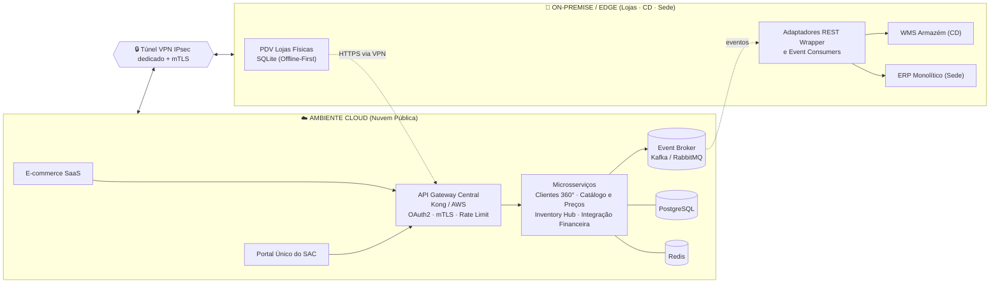
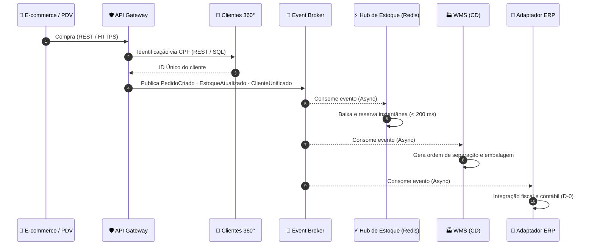

<div align="center">

# 🛒 VarejoTech — Arquitetura de Sistemas Corporativos Omnichannel

### ArchCorp · Etapas 2 e 3 — Requisitos e Projeto de Arquitetura **TO-BE**


-8b5cf6?style=for-the-badge)


-64748b?style=flat-square)

**Projeto Aplicado de Arquitetura Corporativa — ArchCorp**
Documentação da arquitetura TO-BE + protótipo visual interativo para apresentação acadêmica/executiva.

</div>

---

## 📑 Sumário

1. [Visão Geral e Contexto](#-1-visão-geral-e-contexto)
2. [Comparativo AS-IS vs. TO-BE](#-2-comparativo-as-is-vs-to-be)
3. [Arquitetura em 5 Camadas e Fronteiras](#-3-arquitetura-em-5-camadas-e-fronteiras-cloud-vs-on-premise)
4. [Fluxo Detalhado: Ciclo de Venda Omnichannel](#-4-fluxo-detalhado-ciclo-de-venda-omnichannel-6-etapas)
5. [Matriz Completa de Rastreabilidade de Requisitos](#-5-matriz-completa-de-rastreabilidade-de-requisitos)
6. [Protótipo Interativo e Como Executar](#-6-sobre-o-protótipo-interativo-frontend-e-como-executar)
7. [Estrutura do Repositório](#-estrutura-do-repositório)

---

## 🎯 1. Visão Geral e Contexto

A **VarejoTech** opera dois mundos que praticamente não conversam: o **E-commerce** e as **Lojas Físicas (PDV)**. Cada canal mantém seu próprio cadastro de clientes, seu próprio saldo de estoque e depende de **rotinas legadas** (jobs noturnos, arquivos via FTP, planilhas CSV) para trocar informação com o ERP e o WMS.

O objetivo central deste projeto é **eliminar o isolamento operacional entre o e-commerce e as lojas físicas**, substituindo rotinas síncronas legadas e arquivos *batch* por uma **Arquitetura Orientada a Eventos (EDA)** integrada por **APIs RESTful** e um **API Gateway Central**.

> 💡 **Estratégia de modernização:** o ERP monolítico e o WMS **não são reescritos**. Eles são "envelopados" por adaptadores REST (*REST Wrapper*) e consumidores de eventos, o que evita uma substituição onerosa e permite evoluir de forma incremental.

### 🧭 Contexto no projeto ArchCorp

| Etapa | Entrega | Situação neste repositório |
|:-----:|---------|:--------------------------:|
| 1 | Análise do Cenário Atual (AS-IS) | Referenciada |
| 2 | Levantamento de Requisitos (`Requisitos_melhorado.pdf`) | ✅ Documentada |
| 3 | Projeto de Arquitetura TO-BE (`3 - Projeto de Arquitetura.pdf`) | ✅ Documentada + protótipo |
| 4 | Padrões e Estilos Arquiteturais (Circuit Breaker, Transactional Outbox, governança de APIs) | ⏭️ Próximo passo |

---

## 🔄 2. Comparativo AS-IS vs. TO-BE

<table>
<tr>
<th width="50%">🔴 AS-IS — Gargalos Atuais</th>
<th width="50%">🟢 TO-BE — Solução Proposta</th>
</tr>
<tr>
<td valign="top">

- 🌙 **Processamento em lote noturno** via FTP
- 📄 **Exportações manuais de CSV** pela equipe financeira
- 👤 **Ausência de visão unificada do cliente** (cadastros duplicados por canal)
- ⏱️ **Estoque atrasado em até 24h (D+1)**
- 📦 **Risco contínuo de overselling**

</td>
<td valign="top">

- 📡 **Event Broker em tempo real** (Apache Kafka / RabbitMQ)
- ⚡ **Hub de Estoque** com cache em memória (**Redis, < 200 ms**)
- 🧑‍🤝‍🧑 **Serviço de Clientes 360°** (CPF Único no **PostgreSQL**)
- 🏪 **PDV com resiliência Offline-First** (**SQLite** local)

</td>
</tr>
</table>

### 📊 Ganhos esperados

| Dimensão | AS-IS | TO-BE |
|----------|:-----:|:-----:|
| Latência do estoque | até 24h (D+1) | **< 200 ms** |
| Fechamento fiscal/contábil | manual, D+1 | **automático, D-0** |
| Visão do cliente | fragmentada por canal | **única (CPF)** |
| Operação do PDV sem rede | comprometida | **Offline-First** |
| Integração entre sistemas | FTP/CSV em lote | **Eventos + APIs REST** |

---

## 🏛️ 3. Arquitetura em 5 Camadas e Fronteiras (Cloud vs. On-Premise)

A arquitetura TO-BE é organizada em camadas bem definidas para garantir **desacoplamento, escalabilidade e interoperabilidade** entre sistemas SaaS modernos e sistemas legados de backoffice.

### 🧱 Camadas

| # | Camada | Componentes Principais | Tecnologia & Padrão de Integração |
|:-:|--------|------------------------|-----------------------------------|
| **1** | 🖥️ **Canais & Consumidores** (Frontend) | E-commerce SaaS (Nuvem), PDV Lojas Físicas, Portal Único do SAC | HTTPS / REST APIs / Sincronização Local (SQLite) |
| **2** | 🛡️ **Borda & Segurança** (Edge Layer) | **API Gateway Central** (Kong / AWS API Gateway) | **OAuth2**, **mTLS**, **Rate Limiting**, Roteamento & TLS Termination |
| **3** | ⚙️ **Microsserviços Corporativos** | Serviço de Clientes 360°, Catálogo & Preços, Inventory Hub, Integração Financeira | Containers Docker/K8s, APIs RESTful, Cache Redis em Memória |
| **4** | 📡 **Barramento & Mensageria** | Event Broker Central — tópicos `PedidoCriado`, `EstoqueAtualizado`, `ClienteUnificado` | Apache Kafka / RabbitMQ (comunicação assíncrona Pub/Sub) |
| **5** | 🏭 **Sistemas Legados & Backoffice** | WMS Armazém (CD) e ERP Monolítico Backoffice | Adaptadores **REST Wrapper** e *Event Consumers* dedicados |

### 🧩 Componentes, serviços e estrutura de dados

| Componente / Serviço | Tecnologia Proposta | Papel e Responsabilidade |
|----------------------|---------------------|--------------------------|
| API Gateway Central | Kong / AWS API Gateway | Ponto único de entrada, segurança, limitação de taxa e roteamento de APIs síncronas |
| Serviço de Clientes (360°) | Microsserviço (Node.js / Java) | Cadastro único por CPF, eliminando registros duplicados |
| Hub de Estoque (Inventory Hub) | Microsserviço + Redis Cache | Saldos físico/digital unificados com bloqueio instantâneo contra overselling |
| Barramento de Eventos | Apache Kafka / RabbitMQ | Transporte assíncrono desacoplado e tolerante a falhas |
| Banco Operacional Central | PostgreSQL | Persistência relacional ACID para clientes e histórico de pedidos |
| Banco de Borda (PDV) | SQLite / Local Cache | Operação contínua do PDV durante quedas de conexão |
| Adaptador de ERP Legado | REST API Wrapper / Worker | Envelopa o ERP antigo para recepção de vendas e automação fiscal/contábil |

### 🌐 Fronteiras: Nuvem Pública × On-Premise



| Ambiente | O que hospeda |
|----------|---------------|
| ☁️ **Cloud (Nuvem Pública)** | E-commerce SaaS, API Gateway, Microsserviços, Event Broker (+ PostgreSQL e Redis) |
| 🏢 **On-Premise / Edge** | PDVs das Lojas Físicas, WMS no CD e ERP na Sede |
| 🔐 **Conectividade** | Túneis **VPN IPsec dedicados** com autenticação **mTLS** e controle rígido no API Gateway |

### 🔀 Comunicação síncrona × assíncrona

| Tipo | Uso | Exemplos |
|------|-----|----------|
| **Síncrona** (REST / JSON via HTTPS) | Operações que exigem resposta imediata ao usuário | Consulta de CPF no PDV, autenticação de usuários, checagem de preços |
| **Assíncrona** (Event-Driven / Pub-Sub) | Propagação de estados do negócio | Evento `PedidoCriado` — a indisponibilidade do ERP ou do WMS **não paralisa** as vendas |

---

## 🧾 4. Fluxo Detalhado: Ciclo de Venda Omnichannel (6 Etapas)



| Etapa | Ação no Fluxo de Negócio | Componentes Envolvidos | Mecanismo |
|:-----:|--------------------------|------------------------|-----------|
| **1. Início** | Consumidor efetua compra no E-commerce ou PDV da Loja Física | E-commerce / PDV → API Gateway | `REST / HTTPS` |
| **2. Identificação** | Validação do cliente e associação ao **ID Único via CPF** | Serviço de Clientes (360°) | `REST / SQL` |
| **3. Evento** | Publicação do evento de venda realizada no barramento | Event Broker (Kafka / RabbitMQ) | `Async Pub/Sub` |
| **4. Estoque** | **Baixa e reserva instantânea** do saldo no cache em memória | Hub de Estoque (Redis) | `Async Consumer` |
| **5. Expedição** | Geração automática da **ordem de separação e embalagem** | WMS Armazém (CD) | `Async Consumer` |
| **6. Faturamento** | Integração fiscal e lançamento contábil automático **em D-0** | Adaptador ERP Backoffice | `REST Wrapper / Worker` |

> 🛟 **Resiliência:** se o ERP entrar em manutenção, as vendas continuam normalmente e os eventos **permanecem retidos na fila do barramento** até o ERP voltar.

---

## 🗂️ 5. Matriz Completa de Rastreabilidade de Requisitos

Os 20 requisitos abaixo vêm do documento de requisitos da Etapa 2 (`Requisitos_melhorado.pdf`), em 4 categorias, e são mapeados para os elementos da arquitetura TO-BE (Etapa 3).

### 🟢 Requisitos Funcionais (RF)

| ID | Requisito (Etapa 2) | Mapeamento na Arquitetura TO-BE (Etapa 3) | Camadas |
|:--:|---------------------|--------------------------------------------|:-------:|
| **RF-01** | **Visão Única do Cliente (360°)** — unificar o cadastro de consumidores de PDV e E-commerce, com mesma identidade e histórico | Serviço de Clientes 360° + PostgreSQL (CPF Único), exposto via API Gateway | 2, 3 |
| **RF-02** | **Atualização de Estoque Global** — refletir saldo e status de envio do WMS no E-commerce e no PDV, evitando overselling | Hub de Estoque + Redis + evento `EstoqueAtualizado` no Event Broker | 3, 4, 5 |
| **RF-03** | **Automação do Fluxo Financeiro e Faturação** — alimentar relatórios de gestão e dados tributários do ERP automaticamente | Serviço de Integração Financeira + Adaptador de ERP consumindo eventos de venda | 3, 4, 5 |
| **RF-04** | **Sincronização de Catálogo e Preços** — cadastros de produtos e tabelas de preços centralizados e atualizados para PDV e E-commerce | Microsserviço Catálogo & Preços (cache Redis) servido via API Gateway | 2, 3 |
| **RF-05** | **Unificação de Atendimento (SAC)** — interface integrada com dados de logística, pedidos e clientes | Portal Único do SAC consumindo APIs centralizadas (Clientes 360°, pedidos, logística) via API Gateway | 1, 2, 3 |

### 🟣 Requisitos Não Funcionais (RNF)

| ID | Requisito (Etapa 2) | Mapeamento na Arquitetura TO-BE (Etapa 3) | Camadas |
|:--:|---------------------|--------------------------------------------|:-------:|
| **RNF-01** | **Escalabilidade de Processamento** — suportar picos de vendas sem atrasar a comunicação com o ERP | Event Broker desacoplando produtores e consumidores; microsserviços em containers Docker/K8s | 3, 4 |
| **RNF-02** | **Desempenho e Baixa Latência** — comunicação WMS ↔ canais em tempo real, substituindo o D+1 | Eventos assíncronos + Redis em memória (consultas < 200 ms) | 3, 4 |
| **RNF-03** | **Resiliência em Lojas Físicas** — PDV gera cupons e fecha caixa mesmo com rede instável, sincronizando ao reconectar | PDV Offline-First com SQLite local e sincronização com o barramento central | 1, 4 |
| **RNF-04** | **Interoperabilidade** — SaaS na nuvem conversa nativamente com sistemas legados On-Premise | API Gateway, adaptadores REST Wrapper e túnel VPN IPsec + mTLS | 2, 5 |

### 🔵 Requisitos de Integração e Arquitetura (INT)

| ID | Requisito (Etapa 2) | Mapeamento na Arquitetura TO-BE (Etapa 3) | Camadas |
|:--:|---------------------|--------------------------------------------|:-------:|
| **INT-01** | **Substituição de Processamento Batch** — eliminar arquivos batch, CSV e jobs noturnos via FTP | Integrações por eventos e APIs no lugar do FTP noturno | 4, 5 |
| **INT-02** | **Barramento de Mensageria/Eventos** — arquitetura orientada a eventos (Kafka ou RabbitMQ) em tempo real | Event Broker Central com tópicos `PedidoCriado`, `EstoqueAtualizado`, `ClienteUnificado` | 4 |
| **INT-03** | **Padronização via APIs** — APIs RESTful expondo ERP monolítico e WMS | Adaptadores REST Wrapper do ERP e do WMS atrás do API Gateway | 2, 5 |
| **INT-04** | **Eliminação de Processos Manuais** — extinguir a digitação de planilhas CSV pela equipe financeira | Adaptador de ERP + Integração Financeira automatizando o lançamento fiscal/contábil | 3, 5 |

### 🟠 Regras de Negócio (RN)

| ID | Regra (Etapa 2) | Mapeamento na Arquitetura TO-BE (Etapa 3) | Camadas |
|:--:|-----------------|--------------------------------------------|:-------:|
| **RN-01** | **Prevenção de Overselling** — saldo bloqueado instantaneamente quando o pedido é efetivado | Hub de Estoque: baixa/reserva atômica no Redis ao consumir `PedidoCriado` | 3, 4 |
| **RN-02** | **Consistência de Dados Cadastrais** — o PDV busca e reutiliza o ID único existente em vez de criar novo registro | Consulta síncrona por CPF ao Serviço de Clientes 360° (PostgreSQL) | 1, 2, 3 |
| **RN-03** | **Fechamento Contábil D-0** — fechamento de caixa do PDV e pedidos do E-commerce no ERP no mesmo dia, sem intervenção humana | Adaptador de ERP consumindo eventos e integrando fiscal/contábil em D-0 | 4, 5 |

### 🎬 Quais requisitos o protótipo demonstra

| Requisito | Onde ver no protótipo |
|:---------:|-----------------------|
| RF-01, RN-02 | Simulador (etapa 2) e Portal do SAC — busca por CPF |
| RF-02, RN-01 | Simulador (etapa 4) e Monitor do Hub de Estoque; bloqueio por estoque insuficiente |
| RF-03, RN-03, INT-04 | Simulador (etapa 6) — faturamento D-0 |
| RF-05 | Aba "Telas de Negócio" — Portal Único do SAC com histórico unificado |
| RNF-02 | Latência do Redis exibida nos logs e no monitor |
| RNF-03 | Toggle "Queda de Rede no PDV" (SQLite Offline-First) |
| INT-02 | Painel de tópicos do Event Broker |
| RNF-04 | Mapa de arquitetura com o túnel VPN IPsec + mTLS |

> ℹ️ **Nota sobre a numeração:** o documento da Etapa 3 traz uma matriz resumida (7 itens, com `RF-04` = consulta para o SAC e `RNF-01..03` = disponibilidade, desempenho e segurança/LGPD). Esta seção segue a numeração completa do documento de requisitos da Etapa 2. A aba 4 do protótipo exibe a matriz resumida, conforme o documento da Etapa 3 (o protótipo não simula o `RF-04` de catálogo/preços).

---

## 🖥️ 6. Sobre o Protótipo Interativo (Frontend) e Como Executar

O repositório inclui um **protótipo visual interativo** feito para demonstrações acadêmicas e executivas. **Não há backend nem banco de dados reais**: todos os dados e fluxos são simulados em JavaScript, no navegador.

| Arquivo | Função |
|---------|--------|
| [`index.html`](index.html) | Estrutura das 4 abas e dos painéis |
| [`styles.css`](styles.css) | Tema escuro (Slate / Indigo / Emerald), animações, estados da linha do tempo |
| [`app.js`](app.js) | Dados mockados, motor do simulador, telas de negócio, mapa de arquitetura e matriz |

### 🗺️ As 4 abas

| Aba | Conteúdo |
|-----|----------|
| **1 · Visão Geral** | Comparativo AS-IS (alerta) × TO-BE (destaque), indicadores e alternador do fluxo de dados |
| **2 · Simulador Omnichannel** ⭐ | Venda ao vivo em 6 etapas, com logs em tempo real, painel do SQLite do PDV, tópicos do broker e fila do ERP |
| **3 · Telas de Negócio** | **Portal do SAC / Cliente 360°** (busca por CPF, 3 clientes de exemplo, histórico unificado e-commerce + loja) e **Monitor do Hub de Estoque Redis** (atualiza ao simular uma venda) |
| **4 · Arquitetura & Rastreabilidade** | Mapa das 5 camadas com fronteiras Cloud × On-Premise (túnel VPN IPsec + mTLS), detalhes dos componentes, animação do fluxo e matriz filtrável por RF / RNF |

### 🧪 Cenários de teste do simulador

| Cenário | Como reproduzir | O que acontece |
|---------|-----------------|----------------|
| ✅ **Venda normal** | Escolha o canal e clique em **Executar Venda Omnichannel** | As 6 etapas concluem; o estoque é baixado na aba 3 e o pedido entra no histórico do cliente |
| 📴 **Queda de rede no PDV** (Offline-First) | Canal **PDV Loja Física** + toggle **Simular Queda de Rede no PDV** | A venda é gravada no **SQLite local** como `PENDING_SYNC`; o estoque central não muda. Clique em **Restaurar Rede e Sincronizar** para reenviar e concluir o fluxo |
| 🛠️ **ERP em manutenção** | Toggle **Simular Manutenção no ERP Legado** | Etapas 1–5 concluem; a etapa 6 fica **retida na fila do broker** (nenhuma perda). Clique em **ERP Restabelecido — Drenar Fila** (ou desligue o toggle) para faturar |
| 🚫 **Bloqueio de overselling** | Escolha uma quantidade **maior que o saldo** (ex.: 20× Console GameBox) | A reserva atômica é **rejeitada** na etapa 4, as etapas 5–6 são canceladas e o pedido fica como "Cancelado (sem estoque)" |

> A queda de rede só se aplica ao canal PDV. A velocidade (lento / normal / rápido) e o botão de reinício ficam no painel de controles do simulador.

### ▶️ Como executar

Não há build, servidor ou dependências para instalar. Só é necessário um navegador moderno **com acesso à internet** (Tailwind CSS, Lucide Icons e fontes são carregados por CDN).

```bash
# 1. Clone o repositório
git clone https://github.com/CayoCesarMoreira/varejotech-arquitetura-omnichannel.git

# 2. Entre na pasta
cd varejotech-arquitetura-omnichannel

# 3. Abra o protótipo no navegador (ou dê duplo clique em index.html)
start index.html        # Windows
open index.html         # macOS
xdg-open index.html     # Linux
```

---

## 📁 Estrutura do Repositório

```text
.
├── index.html                      # Protótipo — estrutura das abas
├── styles.css                      # Protótipo — estilos e animações
├── app.js                          # Protótipo — lógica e dados simulados
├── Requisitos_melhorado.pdf        # Etapa 2 — documento de requisitos (TO-BE)
├── 3 - Projeto de Arquitetura.pdf  # Etapa 3 — projeto de arquitetura TO-BE
└── README.md
```

---

## 🔭 Próximos passos (Etapa 4)

Detalhar formalmente os **padrões e estilos arquiteturais**: padrões de integração, padrões de resiliência (ex.: *Circuit Breaker*, *Transactional Outbox*) e governança de APIs.

---

<div align="center">

**ArchCorp · Projeto Aplicado de Arquitetura Corporativa** — VarejoTech Omnichannel

*Protótipo de apresentação: todos os dados e fluxos são simulados no frontend.*

</div>
